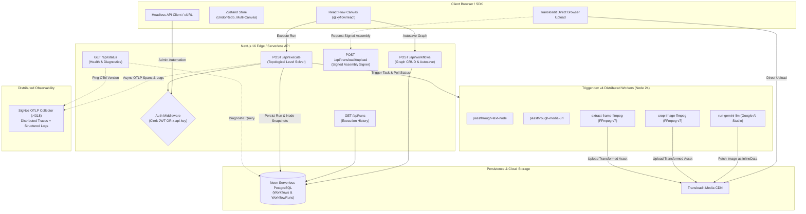
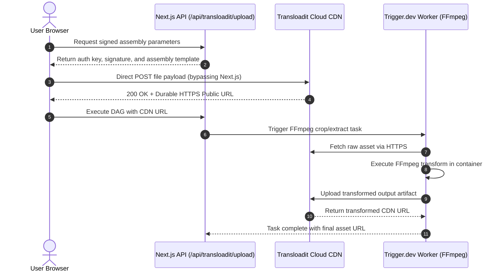

# NextFlow Engineering & Architecture Handbook

> **NextFlow**: A distributed, visual multimodal workflow engine chaining Google Gemini LLM reasoning, FFmpeg media processing, cloud asset storage, and distributed OpenTelemetry observability with zero glue code.

---

## 📑 Table of Contents

1. [System Overview & Architectural Vision](#1-system-overview--architectural-vision)
2. [End-to-End Architecture Blueprint](#2-end-to-end-architecture-blueprint)
3. [Codebase Anatomy & Directory Tour](#3-codebase-anatomy--directory-tour)
4. [Canvas & Client State Architecture](#4-canvas--client-state-architecture)
5. [Topological Execution Engine (Kahn's Algorithm)](#5-topological-execution-engine-kahns-algorithm)
6. [Distributed Worker Compute (Trigger.dev v4)](#6-distributed-worker-compute-triggerdev-v4)
7. [Multimodal AI & Gemini Vision Engine](#7-multimodal-ai--gemini-vision-engine)
8. [Media Pipeline & Cloud Storage (Transloadit + FFmpeg)](#8-media-pipeline--cloud-storage-transloadit--ffmpeg)
9. [Data Layer & Persistence (Prisma + Neon PostgreSQL)](#9-data-layer--persistence-prisma--neon-postgresql)
10. [Authentication & Dual-Tier Authorization](#10-authentication--dual-tier-authorization)
11. [Observability & Telemetry (OpenTelemetry + SigNoz)](#11-observability--telemetry-opentelemetry--signoz)
12. [Complete REST API Specification](#12-complete-rest-api-specification)
13. [Environment Variables & Configuration Matrix](#13-environment-variables--configuration-matrix)
14. [Operations, Deployment & Troubleshooting Runbook](#14-operations-deployment--troubleshooting-runbook)

---

## 1. System Overview & Architectural Vision

### 1.1 The Problem It Solves
Modern AI applications rarely stop at simple text prompts. Production multi-modal pipelines require chaining multiple steps:
* Uploading videos/images
* Extracting frames or cropping regions of interest using FFmpeg
* Feeding extracted visual assets alongside prompt instructions into LLMs (e.g., Google Gemini Vision)
* Storing interim and final media artifacts reliably on high-availability CDNs
* Tracking node-level latency, execution traces, inputs, and outputs

Building these pipelines using ad-hoc scripts or monolithic backend endpoints results in severe challenges:
1. **Serverless Timeouts**: Cloud functions (e.g., Vercel, AWS Lambda) cap execution at 10–15 seconds, breaking long-running video extractions or multi-step LLM chains.
2. **Memory Explosions**: Streaming high-resolution media through Next.js serverless route handlers crashes Node.js runtimes.
3. **Lost State & Opacity**: When step 4 of a 6-step pipeline fails, developers have no visibility into intermediate outputs, node timings, or step failure payloads.

### 1.2 NextFlow's Architectural Solution
NextFlow solves this by establishing a strict separation of concerns:
* **Visual Directed Acyclic Graph (DAG) Canvas**: Users construct and wire nodes via React Flow with typed connection validation.
* **Stateless Topological Dispatcher**: The Next.js API resolves dependencies, detects circular cycles, groups independent nodes into concurrent tiers, and triggers external workers.
* **Durable Background Compute**: Heavy tasks (FFmpeg cropping, frame extraction, Gemini multimodal calls) execute inside containerized **Trigger.dev v4** workers.
* **Cloud Storage Offloading**: File uploads never pass through serverless handlers; client browsers upload directly to **Transloadit** signed assemblies.
* **Full-Stack Observability**: Every execution emits OpenTelemetry traces and structured logs to **SigNoz** with full trace-to-node correlation.

---

## 2. End-to-End Architecture Blueprint

The following diagram illustrates the complete request lifecycle across client, API, database, background workers, and telemetry systems:



---

## 3. Codebase Anatomy & Directory Tour

```
nextflow/
├── docs/                        # Architectural documentation and guides
│   ├── TRANSLOADIT.md           # Transloadit assembly contracts & upload debugging
│   ├── TRIGGER_ENV.md           # Trigger.dev v4 worker environment setup
│   └── VERCEL.md                # Vercel deployment checklists & pooled Postgres config
├── prisma/
│   ├── migrations/              # PostgreSQL schema migrations
│   └── schema.prisma            # Prisma models (Workflow, WorkflowRun)
├── src/
│   ├── app/                     # Next.js 16 App Router
│   │   ├── api/                 # Serverless API routes
│   │   │   ├── execute/         # POST /api/execute: Topological DAG engine
│   │   │   ├── runs/            # GET /api/runs: Workflow run history queries
│   │   │   ├── status/          # GET /api/status: System health & diagnostics
│   │   │   ├── transloadit/     # Signed media upload assembly generation
│   │   │   └── workflows/       # CRUD operations for canvas workflows
│   │   ├── canvas/              # /canvas route for visual builder
│   │   ├── workflow/            # /workflow route (primary canvas workspace)
│   │   ├── sign-in/             # Clerk authentication sign-in
│   │   ├── sign-up/             # Clerk authentication sign-up
│   │   ├── globals.css          # Tailwind CSS v4 design tokens
│   │   ├── layout.tsx           # Root HTML layout with ClerkProvider
│   │   └── page.tsx             # Root redirect handler
│   ├── components/
│   │   └── workflow-builder.tsx # Primary React Flow visual canvas & custom node UIs
│   ├── lib/
│   │   ├── auth.ts              # Dual auth handler: Clerk session vs x-api-key
│   │   ├── gemini-execute.ts    # Google AI Studio SDK wrapper with vision inlining
│   │   ├── graph.ts             # Graph validation utilities
│   │   ├── log-sanitizer.ts     # PII/Secret redaction & byte truncation for logs
│   │   ├── prisma.ts            # Singleton PrismaClient with auto-discovery
│   │   ├── sample-workflow.ts   # Default starter workflow templates
│   │   ├── telemetry.ts         # OpenTelemetry trace and log exporters for SigNoz
│   │   ├── trigger-errors.ts    # Error unwrappers for background task failures
│   │   └── trigger-from-api.ts  # API-to-Trigger.dev task trigger & polling bridge
│   ├── store/
│   │   └── workflow-store.ts    # Zustand state machine (graph, undo/redo, switcher)
│   ├── trigger/
│   │   └── tasks.ts             # Trigger.dev task declarations (FFmpeg, Gemini, Text)
│   ├── types/
│   │   └── workflow.ts          # Core TypeScript definitions (nodes, edges, runs)
│   └── middleware.ts            # Route protection guard with API key bypass
├── trigger.config.ts            # Trigger.dev v4 project, Node 24 runtime & FFmpeg config
├── eslint.config.mjs            # ESLint 9 native flat configuration
├── next.config.ts               # Next.js standalone build & serverActions config
├── package.json                 # Dependency tree & CLI scripts
└── tsconfig.json                # TypeScript compiler configuration
```

---

## 4. Canvas & Client State Architecture

### 4.1 React Flow Custom Node Architecture
The frontend canvas (`src/components/workflow-builder.tsx`) is built on `@xyflow/react` and renders 5 specialized node types:

| Node Type | Category | Input Ports | Output Ports | Visual Features |
|:---|:---:|:---|:---|:---|
| **`text`** | Primitive | None (direct textarea) or linked string | `text` (PortType: text) | Monospace prompt/text editor |
| **`uploadImage`** | Media | None (direct upload) | `image` (PortType: image) | Transloadit dropzone with live preview |
| **`uploadVideo`** | Media | None (direct upload) | `video` (PortType: video) | Transloadit video dropzone with preview |
| **`runAnyLlm`** | AI Engine | `prompt` (text), `image` (image), `system` (text) | `text` (PortType: text) | Model selector, temperature slider, result pane |
| **`cropImage`** | Media Transform | `imageUrl` (image), `x`, `y`, `width`, `height` (numbers) | `imageUrl` (PortType: image) | Coordinate inputs + cropped output preview |
| **`extractFrame`** | Media Transform | `videoUrl` (video), `timestamp` (text/number) | `frameUrl` (PortType: image) | Timestamp seeker (`12.5s` or `50%`) + preview |

### 4.2 Typed Connection Enforcement
Connection handles are strictly typed:
* An edge connecting an `image` output to a `number` input is rejected at connection time.
* Connected edges are styled with a distinct purple accent (`#a855f7`) with smooth bezier curves and animated markers during execution.

### 4.3 Zustand State Machine (`src/store/workflow-store.ts`)
The visual editor maintains state via Zustand without re-rendering unnecessary components:
* **Canvas State**: `nodes`, `edges`, `workflowId`, `workflowName`.
* **Undo / Redo Stack**: Stores immutable snapshots of `{ nodes, edges }` on every mutation. Keyboard listeners intercept `Cmd+Z` and `Cmd+Shift+Z`.
* **Multi-Canvas Switcher**: Allows users to seamlessly switch between saved workflows or create a clean slate using `resetWorkflow()`.
* **Run History Integration**: Stores an array of `WorkflowRun` records with per-node status badges (`success`, `failed`, `running`).

---

## 5. Topological Execution Engine (Kahn's Algorithm)

### 5.1 The Algorithm
When a user clicks **Run Full** or triggers `POST /api/execute`, the serverless handler parses the graph and resolves node dependencies using a modified topological sort:

1. **In-Degree Calculation**: Every node's in-degree (number of incoming edges) is calculated.
2. **Cycle Detection**: If the graph contains a directed cycle (e.g., $A \to B \to C \to A$), Kahn's algorithm fails to visit all nodes, and the engine immediately aborts with an HTTP 400 and clear cycle diagnosis.
3. **Execution Tiers (Levels)**:
   * Level 0 contains all nodes with 0 incoming dependencies (root Text and Media nodes).
   * Level 1 contains nodes whose inputs depend exclusively on Level 0 outputs.
   * Level $N$ depends on outputs from Levels $< N$.
4. **Concurrent Execution**: Nodes within the same tier execute in parallel via `Promise.allSettled()`, dramatically reducing total pipeline duration.

### 5.2 Execution Scopes
* **`full`**: Executes the entire DAG from root nodes to terminal leaves.
* **`partial`**: Executes only the user-selected nodes along with their prerequisite upstream ancestor nodes.
* **`single`**: Isolates a single node for fast debugging using cached or inline mock inputs.

---

## 6. Distributed Worker Compute (Trigger.dev v4)

### 6.1 Why Trigger.dev v4?
Executing FFmpeg media clipping or multi-modal LLM reasoning inside Next.js serverless route handlers introduces significant risks:
* AWS Lambda / Vercel 15-second execution ceilings.
* High memory costs for image/video buffers.
* Socket drops if client connection is interrupted.

NextFlow offloads all compute to containerized background tasks defined in `src/trigger/tasks.ts`.

### 6.2 Task Registry
1. **`passthrough-text-node`**: Normalizes and returns string constants.
2. **`passthrough-media-url`**: Validates URL protocols (HTTPS) and reachable media endpoints.
3. **`run-gemini-llm`**: Executes Google Gemini with system instructions and image buffers.
4. **`crop-image-ffmpeg`**: Spawns an FFmpeg child process:
   ```bash
   ffmpeg -i input.jpg -filter:v "crop=w:h:x:y" output.jpg
   ```
5. **`extract-frame-ffmpeg`**: Probes video duration and extracts exact JPEG frames using percentage or second offsets:
   ```bash
   ffmpeg -ss 00:00:15 -i input.mp4 -vframes 1 -q:v 2 output.jpg
   ```

### 6.3 Worker Configuration (`trigger.config.ts`)
* **Runtime**: Containerized `node-24`.
* **Extensions**:
  * `ffmpeg({ version: "7" })`: Injects compiled FFmpeg binaries into the cloud worker container.
  * `syncEnvVars()`: Automatically synchronizes secrets (`GEMINI_API_KEY`, `TRANSLOADIT_AUTH_KEY`, `TRANSLOADIT_AUTH_SECRET`) to Trigger workers on deployment.

---

## 7. Multimodal AI & Gemini Vision Engine

### 7.1 In-Memory Vision Inlining (`src/lib/gemini-execute.ts`)
Google Gemini's API accepts multimodal inputs in two ways:
1. Google Cloud File API (requires GCP bucket storage setup).
2. Base64 `inlineData` buffers.

Passing raw public URLs in prompt text often causes Gemini to hallucinate or fail if the external CDN blocks Google's crawler. NextFlow implements an **in-memory streaming bridge**:
1. The worker fetches the media asset over HTTPS from the Transloadit CDN directly into a memory buffer.
2. Validates that the file size does not exceed the configurable limit (`GEMINI_VISION_MAX_IMAGE_BYTES`, default 4MB).
3. Detects MIME type (`image/png`, `image/jpeg`, `image/webp`).
4. Converts the buffer into an `inlineData` object:
   ```ts
   const inlinePart = {
     inlineData: {
       data: buffer.toString("base64"),
       mimeType: detectedMimeType
     }
   };
   ```
5. Appends the image part to the prompt array, allowing Gemini 2.5 Flash / 1.5 Pro to perform high-resolution visual reasoning.

---

## 8. Media Pipeline & Cloud Storage (Transloadit + FFmpeg)



1. **Zero Serverless Congestion**: Files are sent directly from the client's browser to Transloadit using signed Assembly instructions.
2. **Cryptographic Signatures**: The backend generates HMAC signatures using `TRANSLOADIT_AUTH_SECRET` to prevent unauthorized file injection.
3. **Persistent URLs**: Transloadit serves all artifacts over a high-speed global CDN, ensuring downstream workers and Gemini can fetch assets with low latency.

---

## 9. Data Layer & Persistence (Prisma + Neon PostgreSQL)

### 9.1 Database Schema (`prisma/schema.prisma`)
The system utilizes two primary relational models:

```prisma
model Workflow {
  id        String        @id @default(cuid())
  userId    String
  name      String
  graphJson Json
  createdAt DateTime      @default(now())
  updatedAt DateTime      @updatedAt
  runs      WorkflowRun[]
}

model WorkflowRun {
  id          String   @id @default(cuid())
  workflowId  String
  userId      String
  scope       String
  status      String
  durationMs  Int
  detailsJson Json
  createdAt   DateTime @default(now())
  workflow    Workflow @relation(fields: [workflowId], references: [id], onDelete: Cascade)
}
```

### 9.2 Key Design Decisions
* **`graphJson` Flexibility**: Stores React Flow nodes and edges in raw JSON format, enabling instant schema evolution without requiring database migrations for new node parameters.
* **`detailsJson` Execution Snapshots**: Captures the exact input snapshots, output values, execution duration in milliseconds, and error messages for every individual node in a run.
* **Serverless Connection Pooling**: Configured with `@prisma/adapter-neon` to avoid exhausting database connection pools during bursts of concurrent serverless requests.

---

## 10. Authentication & Dual-Tier Authorization

NextFlow enforces a dual-tier security model implemented in `src/middleware.ts` and `src/lib/auth.ts`:

### 10.1 Tier 1: Interactive User Sessions (Clerk)
* Used by human operators visiting the `/workflow` or `/canvas` pages.
* Authenticated via Clerk session JWTs passed in browser cookies.
* Every database query is scoped to `where: { userId }`, preventing cross-tenant data access.

### 10.2 Tier 2: Headless Machine-to-Machine Automation (`NEXTFLOW_API_KEY`)
* Used by external microservices, CI/CD pipelines, and health monitors.
* Authenticated by providing `x-api-key: <NEXTFLOW_API_KEY>` or `Authorization: Bearer <NEXTFLOW_API_KEY>`.
* Middleware allows valid API key requests to bypass Clerk redirection, and API routes treat the caller as an administrative operator.

---

## 11. Observability & Telemetry (OpenTelemetry + SigNoz)

NextFlow provides built-in enterprise observability by transmitting OpenTelemetry traces and structured logs to a SigNoz collector (or any standard OTLP endpoint on port `4318`).

### 11.1 Distributed Tracing (`sendSpansToSigNoz`)
Every execution run generates:
1. **Root Span**: Named `workflow.run [<scope>] <workflowName>` tracking total execution time.
2. **Child Spans**: One span for each node in the DAG, recording:
   * `workflow.id` & `workflow.name`
   * `node.id`, `node.label`, and `node.type`
   * `run.id` and `run.status`
   * Step latency in nanoseconds (`startTimeUnixNano`, `endTimeUnixNano`)

### 11.2 Structured Logging (`sendLogsToSigNoz`)
Emits JSON log records with standard OTel severity numbers:
* `9` (`INFO`): Successful node executions and run completions.
* `17` (`ERROR`): Failed steps, timeouts, and validation errors.

### 11.3 Log Sanitization & Redaction (`src/lib/log-sanitizer.ts`)
To protect user privacy and prevent telemetry buffer overflow:
* **Token Redaction**: Automatically scans and strips API keys (e.g., `AIzaSy...`, `sk_...`, `tr_dev_...`).
* **Payload Truncation**: Strings and base64 buffers exceeding 2,048 characters are truncated before being persisted to PostgreSQL or sent to SigNoz.

---

## 12. Complete REST API Specification

### 1. `POST /api/execute`
Executes a workflow DAG.
* **Headers**: `Content-Type: application/json`, optional `x-api-key`
* **Request Payload**:
  ```json
  {
    "workflowId": "cuid_optional",
    "name": "Market Kit Pipeline",
    "scope": "full",
    "selectedNodeIds": ["node-1"],
    "nodes": [
      { "id": "text-1", "type": "text", "data": { "text": "Draft a product launch tweet." } },
      { "id": "llm-1", "type": "llm", "data": { "model": "gemini-2.5-flash" } }
    ],
    "edges": [
      { "id": "e1", "source": "text-1", "target": "llm-1", "sourceHandle": "text", "targetHandle": "prompt" }
    ]
  }
  ```
* **Response (200 OK)**:
  ```json
  {
    "status": "success",
    "durationMs": 1420,
    "workflowId": "cm1234567890",
    "runId": "run_0987654321",
    "nodeResults": {
      "llm-1": { "text": "Excited to introduce NextFlow! 🚀 Build AI workflows visually." }
    },
    "details": [
      {
        "nodeId": "llm-1",
        "nodeLabel": "Run Any LLM",
        "status": "success",
        "executionMs": 1350,
        "inputSnapshot": { "prompt": "Draft a product launch tweet." },
        "outputSnapshot": { "text": "Excited to introduce NextFlow! 🚀..." }
      }
    ]
  }
  ```

### 2. `GET /api/status`
Returns real-time health diagnostics for the database, engine, and telemetry collectors.
* **Response (200 OK)**:
  ```json
  {
    "status": "online",
    "engine": "NextFlow Workflow Engine v1.0.0",
    "database": {
      "connected": true,
      "latencyMs": 42,
      "counts": { "workflows": 10, "runs": 48 }
    },
    "signoz": {
      "connected": true,
      "endpoint": "http://127.0.0.1:4318",
      "version": "active",
      "apiKeyConfigured": false
    },
    "timestamp": "2026-10-27T22:00:00.000Z"
  }
  ```

### 3. `POST /api/workflows`
Saves or updates a workflow graph.
* **Payload**: `{ "id": "optional_id", "name": "Workflow Name", "graphJson": { "nodes": [...], "edges": [...] } }`

### 4. `DELETE /api/workflows?id=<id>`
Permanently deletes a workflow and cascades deletion to all associated `WorkflowRun` records.

---

## 13. Environment Variables & Configuration Matrix

| Variable | Required | Scope | Description |
|:---|:---:|:---:|:---|
| `DATABASE_URL` | **Yes** | Server | PostgreSQL connection string (Neon pooled string recommended) |
| `NEXT_PUBLIC_CLERK_PUBLISHABLE_KEY` | **Yes** | Client/Server | Clerk public key for client-side authentication widgets |
| `CLERK_SECRET_KEY` | **Yes** | Server | Clerk backend secret key for JWT verification |
| `GEMINI_API_KEY` | **Yes** | Worker | Google AI Studio API key for Gemini LLM and Vision |
| `GEMINI_MODEL` | No | Worker | Default Gemini model override (default: `gemini-2.5-flash`) |
| `GEMINI_VISION_MAX_IMAGE_BYTES` | No | Worker | Maximum byte size for in-memory vision inlining (default: `4194304` = 4MB) |
| `TRIGGER_PROJECT_ID` | **Yes** | Server/Worker | Trigger.dev project identifier (`proj_...`) |
| `TRIGGER_SECRET_KEY` | **Yes** | Server | Trigger.dev server secret key (`tr_dev_...` or `tr_prod_...`) |
| `TRANSLOADIT_AUTH_KEY` | **Yes** | Client/Worker | Transloadit public key for direct uploads and assembly creation |
| `TRANSLOADIT_AUTH_SECRET` | **Yes** | Server/Worker | Transloadit secret for signing upload parameters and API access |
| `NEXTFLOW_API_KEY` | No | Server | Secret key enabling automated M2M admin authentication |
| `OTEL_EXPORTER_OTLP_ENDPOINT` | No | Server | OpenTelemetry collector URL (default: `http://127.0.0.1:4318`) |
| `SIGNOZ_ENDPOINT` | No | Server | SigNoz frontend or API endpoint (default: `http://127.0.0.1:8080`) |
| `SIGNOZ_API_KEY` | No | Server | Ingestion key for SigNoz Cloud instances |

---

## 14. Operations, Deployment & Troubleshooting Runbook

### 14.1 Local Development Setup
1. **Clone repository and install dependencies**:
   ```bash
   git clone https://github.com/HIMpcgithub3000/nextflow.git
   cd nextflow
   npm install
   ```
2. **Configure environment**:
   ```bash
   cp .env.example .env.local
   # Populate DATABASE_URL, CLERK keys, GEMINI_API_KEY, TRIGGER keys, and TRANSLOADIT keys
   ```
3. **Database initialization**:
   ```bash
   npx prisma generate
   npx prisma migrate dev
   ```
4. **Run local servers**:
   * Terminal 1 (Next.js): `npm run dev`
   * Terminal 2 (Trigger.dev Worker): `npm run trigger:dev`
5. **Open workspace**: Navigate to [http://localhost:3000/workflow](http://localhost:3000/workflow).

### 14.2 Production Deployment (Vercel + Trigger.dev Cloud)
1. **Deploy Background Workers**:
   ```bash
   npm run trigger:deploy
   ```
   *Note: This packages container dependencies (FFmpeg v7) and synchronizes environment secrets to Trigger.dev Cloud.*
2. **Deploy Next.js App to Vercel**:
   * Connect your GitHub repository to Vercel.
   * Add all production environment variables from `.env.local` to the Vercel dashboard.
   * Ensure `TRIGGER_SECRET_KEY` is set to the **production** key (`tr_prod_...`), not the development key.
   * Deploy!

### 14.3 Common Failure Modes & Quick Fixes

* **Symptom: `Error: GoogleGenerativeAI Error: API key not valid`**
  * *Cause*: Missing `GEMINI_API_KEY` on Trigger.dev cloud worker.
  * *Fix*: Run `npm run trigger:deploy` so that `syncEnvVars` in `trigger.config.ts` pushes local credentials to cloud workers.

* **Symptom: FFmpeg crop or extract node fails with `spawn ENOENT`**
  * *Cause*: FFmpeg is not installed on local `PATH`.
  * *Fix*: Install FFmpeg locally (`brew install ffmpeg`) or set `FFMPEG_PATH=/opt/homebrew/bin/ffmpeg`. Cloud workers automatically use the containerized FFmpeg extension.

* **Symptom: `Cycle detected in workflow graph`**
  * *Cause*: User connected nodes in a circular dependency loop ($A \to B \to A$).
  * *Fix*: Disconnect feedback edges; DAGs must flow strictly unidirectionally.

---

<div align="center">
  <sub>NextFlow Engineering & Architecture Handbook • Maintained by the Core Team</sub>
</div>
